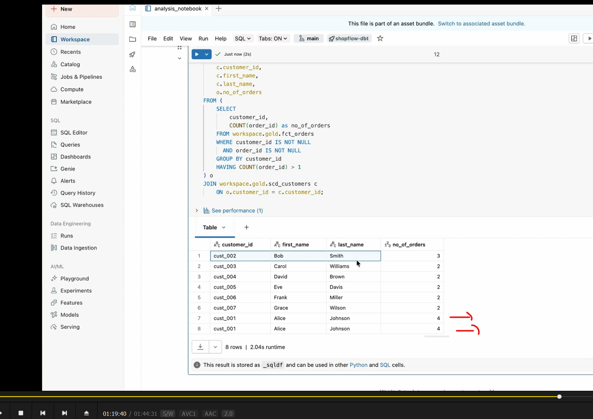
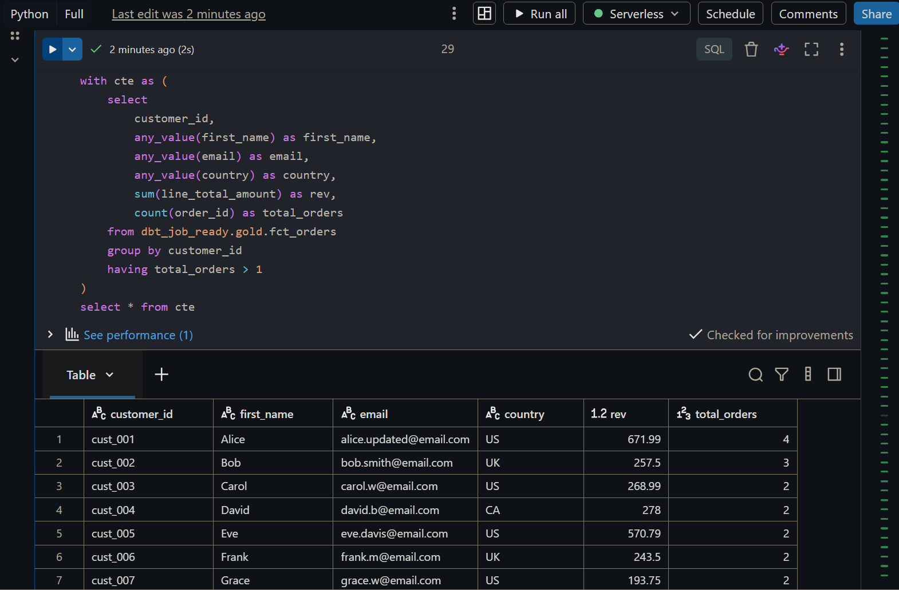
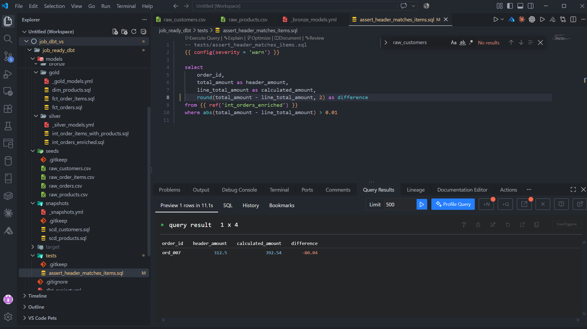

# job_ready_dbt

An industry-standard, analytics-engineering-grade dbt modeling project for an e-commerce / retail domain. It implements modular layered architecture (Bronze/Staging → Intermediate → Marts), incremental processing with anti-fan-out aggregation design, surrogate key governance, and automated data quality tests.

## 📐 Architecture & Lineage

```
Seeds / Sources
├── raw_customers      ──► stg_customers ──► scd_customers (Snapshot, Type 2 SCD)
├── raw_products       ──► stg_products  ──► scd_products (Snapshot, Type 2 SCD)
├── raw_orders         ──► stg_orders
└── raw_order_items    ──► stg_order_items

Intermediate (Silver)
├── int_order_items_with_products   ← stg_order_items + scd_products (current only) + stg_orders
└── int_orders_enriched             ← stg_orders + stg_order_items (aggregated) + scd_customers (current only)

Marts (Gold)
├── dim_products       ← scd_products (current only, non-historized for BI)
├── fct_order_items    ← int_order_items_with_products (Incremental, line-item grain)
└── fct_orders         ← int_orders_enriched (Incremental, order grain)
```

## ⚙️ Materialization & Storage Strategy

To balance execution agility, cloud storage costs, and query performance, the project adopts a tiered materialization strategy across layers:

- **Staging (`models/bronze/`)**: `+materialized: view` — Lightweight, zero-storage transformations that always pull the latest raw seed/source data on-the-fly.
- **Intermediate (`models/silver/`)**: `+materialized: view` — Encapsulates complex joins and pre-aggregations as views to avoid redundant physical storage while keeping business logic modular.
- **Marts (`models/gold/`)**: `+materialized: table` — Heavy analytics-ready tables optimized for BI consumption. Fact models (`fct_orders`, `fct_order_items`) specifically leverage an **incremental** strategy with `merge` to process only new or updated rows (based on an `updated_at` watermark) efficiently.

## 📁 Project Structure

```
job_ready_dbt/
├── analyses/
├── macros/
├── models/
│   ├── bronze/
│   │   ├── _bronze_models.yml
│   │   ├── stg_customers.sql
│   │   ├── stg_orders.sql
│   │   ├── stg_order_items.sql
│   │   └── stg_products.sql
│   ├── silver/ (intermediate)
│   │   ├── int_order_items_with_products.sql
│   │   └── int_orders_enriched.sql
│   └── gold/ (marts)
│       ├── dim_products.sql
│       ├── fct_order_items.sql
│       ├── fct_orders.sql
│       └── _gold_models.yml
├── snapshots/
│   ├── scd_customers.sql
│   └── scd_products.sql
├── tests/
│   └── assert_header_matches_items.sql
├── seeds/
│   ├── raw_customers.csv
│   ├── raw_orders.csv
│   ├── raw_order_items.csv
│   └── raw_products.csv
└── dbt_project.yml
```

## 🧱 Layer-by-Layer Breakdown

### 1. Staging Layer (`models/bronze/`)

**Purpose:** Clean raw seed/source data, standardize text fields (`trim()`, `lower()`, `upper()`), enforce strict casting (`DATE`), and declare schema tests (`unique`, `not_null`, `relationships`).

**Models:**

- `stg_orders`: Casts `order_date` to `DATE` and `created_at` / `updated_at` to `TIMESTAMP`.
- `stg_order_items`: Structural passthrough; casts `created_at` / `updated_at` to `TIMESTAMP`.
- `stg_products`: Trims product names and categories, casts `price` to `DECIMAL(10,2)` and the timestamps, and deduplicates to one row per `product_id` (latest `updated_at`) with `qualify row_number()`.

**`stg_customers` — Dedicated Customer Staging Model:** Customer data is cleaned and standardized in `stg_customers` using `trim()`, `lower()`, and `upper()` for names, emails, and country fields, and deduplicated to one row per `customer_id` (latest `created_at`) with `row_number()`. The `scd_customers` snapshot references this staging model to track historical changes (SCD Type 2). This separation keeps data cleansing in the staging layer and change tracking in the snapshot layer, avoiding duplicated transformation logic.

### 2. Intermediate Layer (`models/silver/`)

**Purpose:** Encapsulate complex business logic, pre-aggregate one-to-many relationships before joining to header tables to prevent metric inflation (fan-out trap), and bind active Slowly Changing Dimensions (SCD).

**Models:**

- `int_order_items_with_products`: Joins order items with product catalogs and order metadata, computing line-item totals (`quantity * unit_price`). **Crucially, it joins `scd_products` filtered by `where dbt_valid_to is null` to prevent SCD2 fan-out.**
- `int_orders_enriched`: Pre-aggregates `stg_order_items` (`line_items`, `total_quantity`, `total_revenue` grouped by `order_id`) prior to joining with `stg_orders` and active SCD customer records (`scd_customers` where `dbt_valid_to is null`).

**Why two intermediate models at two different grains:** the business questions this project needs to answer fall into two distinct grains. Questions about *orders as a whole* — revenue per order, average order value, orders per week — need **one row per order** (order grain), which is why `int_orders_enriched` deliberately collapses item-level rows into per-order summary metrics. Questions about *what was sold* — revenue by product/category, units sold per product — need **one row per order line** (line grain), which is why `int_order_items_with_products` intentionally does *not* aggregate and instead keeps every line item. This is a deliberate grain decision, producing the two separate fact tables (`fct_orders`, `fct_order_items`) in the marts layer below.

### 3. Marts Layer (`models/gold/`)

**Purpose:** Analytics-ready fact and dimension models optimized for BI tool consumption (Tableau, Looker, Power BI).

**Models:**

- `dim_products`: Current-state product dimension built from `scd_products` filtered with `dbt_valid_to is null`, so there is exactly one row per `product_id` (the full SCD Type 2 history stays in the `scd_products` snapshot). The surrogate key `product_key` is generated from `product_id` alone and is the same expression used for `fct_order_items.product_key`, so the fact-to-dimension join is 1:1. `dbt_valid_from` / `dbt_valid_to` are kept as audit columns (`dbt_valid_to` is always null in this table).
- `fct_order_items`: Incremental fact table tracking line-item transactional performance.
- `fct_orders`: Incremental fact table tracking order-level metrics, enriched customer profiles, and aggregate revenue.

## ⚡ Incremental Strategy & Watermarking

Both fact models (`fct_orders`, `fct_order_items`) use incremental materialization with a `merge` strategy. Each model applies a watermark based on its primary source entity's update timestamp.

**`fct_orders` — Order-level watermark:**

```sql

    where updated_at > (
        select max(updated_at) from {{ this }}
    )

```

**`fct_order_items` — Order-item-level watermark:**

```sql

    where order_item_updated_at > (
        select max(order_item_updated_at) from {{ this }}
    )

```

**Limitation:** These watermarks detect changes to their respective source entities. Changes in joined or aggregated upstream tables may not trigger an incremental update unless the relevant source timestamps are incorporated into the change-detection logic. The filter is also a strict `>`, so a late-arriving row whose `updated_at` equals the current maximum would be skipped; `>=` combined with the `qualify` dedup would close that gap.

- **Unique Keys:** `order_key` (`fct_orders`), `order_item_key` (`fct_order_items`).
- **Merge Update Governance:** `merge_update_columns` restricts each merge to a whitelist of mutable columns. `fct_orders` updates `status`, `line_items`, `total_quantity`, `line_total_amount`, `country` and `updated_at`; `fct_order_items` updates `quantity`, `unit_price`, `line_total` and `order_item_updated_at`. Columns not on the list (for example `total_amount`, the customer name/email, and the denormalized order columns in `fct_order_items`) are written when a row is first inserted but are not changed by later merges; refreshing them requires `--full-refresh`.

### ✅ Resolved: `order_date` Could Not Serve as a Change-Detection Watermark

**The problem (as originally shipped):** the watermark filtered on `order_date`, which is the date the order was **first created** and never changes afterward. `merge_update_columns` was configured under the assumption that mutable attributes (like `status`) would be re-selected and merged whenever they changed. **These two things were incompatible**: `order_date` can only tell dbt "this is a new order," never "this existing order was updated." `merge_update_columns` silently failed to do its job for any order whose `order_date` fell before the current max.

**Fix applied:** added `created_at` / `updated_at` audit columns to `raw_orders` and `raw_order_items`, threaded them through `stg_orders` → `int_orders_enriched` → `fct_orders` (and the equivalent `order_items` chain), and repointed both incremental filters at `updated_at`. Verified via `dbt run --full-refresh` after the schema change.

> **Note on rolling out this kind of fix:** `fct_orders`/`fct_order_items` are `incremental` models. Once a table already exists, `dbt run` on an incremental model does a `MERGE` against the existing structure — it does **not** re-run `CREATE TABLE AS SELECT`, so newly added columns like `updated_at` won't appear on their own. Adding columns to an incremental model's output requires `dbt run --full-refresh`.

### ✅ Resolved: SCD2 Product Dimension Caused Fan-out in Line-Item Fact Models

**The problem (discovered during implementation):**

Initially, `int_order_items_with_products` joined directly to `stg_products`, which contained duplicate `product_id` records and caused row multiplication (fan-out).

I then switched the join to `scd_products`, but the duplication persisted because the SCD Type 2 snapshot contained multiple historical versions for the same `product_id`.

**Fix applied:** I added `WHERE dbt_valid_to IS NULL` to the `scd_products` join, ensuring that each order item matches only the current active product version.

Additionally, I introduced `ROW_NUMBER()` deduplication in `stg_products` to guarantee one row per `product_id` before snapshot processing.

This separates two responsibilities:
- **Staging:** Cleans and deduplicates source records.
- **Snapshot:** Preserves historical product changes, while downstream joins select only the active version.

**Verification:** After applying the filter, the `unique_int_order_items_with_products_order_item_id` test passed (`PASS=4, ERROR=0`), and row counts remained perfectly flat from source to silver.

### ✅ Resolved: No Defensive Deduplication Before Merge (test coverage added)

```
unique_key='order_key' is a MATCH key for merge, not a dedup guarantee.
dbt does not dedupe the incoming batch — it assumes upstream already
returns 1 row per key.

Risk: if scd_customers ever returns >1 "current" row per customer_id
(snapshot anomaly), the join fans out → duplicate order_id → duplicate
rows silently inserted into fct_orders.
```

**Fix applied:** added `unique` + `not_null` tests on the gold-layer surrogate keys:

```yaml
# models/gold/_gold_models.yml
version: 2

models:
  - name: fct_orders
    columns:
      - name: order_key
        tests: [unique, not_null]

  - name: fct_order_items
    columns:
      - name: order_item_key
        tests: [unique, not_null]

  - name: dim_products
    columns:
      - name: product_key
        tests: [unique, not_null]
```

**Latest run: `PASS=19 WARN=1 ERROR=0 TOTAL=20`.** 
*(Note: The single `WARN` is the intentionally designed singular test `assert_header_matches_items`, successfully intercepting the upstream data anomaly without crashing the pipeline.)*

**Fix applied — dedup backstop added:** both fact models now include a `qualify row_number() = 1` step after their `final` CTE's `from`, so a fan-out can no longer produce duplicate rows in the first place:

```sql
-- fct_orders.sql
    final as (
        select ...
        from orders_enriched
        qualify row_number() over (partition by order_id order by updated_at desc) = 1
    )

-- fct_order_items.sql
    final as (
        select ...
        from order_items
        qualify row_number() over (partition by order_item_id order by order_item_updated_at desc) = 1
    )
```

**Why `qualify`:** equivalent to writing an extra CTE, just without the extra CTE. `qualify` must come after `from` (like `having` comes after `group by`) — it filters on the window function's result, which only exists after `from` has been evaluated.

**Note on partition keys:** `fct_orders` deduplicates by `order_id`, while `fct_order_items` deduplicates by `order_item_id`. Both partition keys align with their respective fact-table grains and surrogate key generation logic, ensuring at most one row per business key within each processed batch.

Verified via `dbt run --select fct_orders fct_order_items` (no `--full-refresh` needed): both models built successfully, `PASS=2 WARN=0 ERROR=0`.

**End-to-end upsert test:** `ord_018`'s `status`/`updated_at` was edited in place and a brand-new `ord_021` row was added to `raw_orders.csv`, then re-run incrementally. Both landed correctly in `gold.fct_orders`, confirming the `merge_update_columns` config now does what it was always meant to do.

## 📊 Ad-hoc Analyses & Business Insights

To validate that the Gold-layer fact models effectively answer core e-commerce questions, verification and ad-hoc analysis queries are maintained under `analyses/`:

1. **Top Products by Revenue & Units Sold** — ranks products by total revenue and units sold using line-item grain metrics (`line_total`, `quantity`) from `fct_order_items`.
2. **Category-Level Revenue Breakdown** — aggregates `fct_order_items` by `category` to evaluate revenue contribution per product category.
3. **Average Order Value per Month** — buckets `fct_orders` by `date_trunc('month', order_date)`, computing monthly revenue, order count, and AOV.
4. **Revenue by Country** — aggregates `fct_orders` by `country`.
5. **Top Customers by Revenue** — joins `fct_orders` to `scd_customers` (`dbt_valid_to is null`, current customer attributes only) to rank customers by total revenue and order count.
6. **Repeat Customers** — a `having count(order_id) > 1` filter on `fct_orders` grouped by `customer_id`, joined back to `scd_customers` for contact details.

### Query Verifications (Tested in Databricks)

#### 1. Top Products by Revenue & Units Sold
```sql
select
    product_id, 
    product_name,
    sum(line_total) as revenue,
    sum(quantity) as total_quantity
from dbt_job_ready.gold.fct_order_items
group by 1, 2
order by revenue desc
limit 10;
```

#### 2. Category-Level Revenue Breakdown
```sql
select
    category,
    sum(line_total) as total_revenue,
    round(sum(line_total) / sum(sum(line_total)) over () * 100, 2) as revenue_pct
from dbt_job_ready.gold.fct_order_items
group by category
order by total_revenue desc;
```

#### 3. Average Order Value per Month
```sql
select
    date_trunc('month', order_date) as order_month,
    count(order_id) as order_count,
    sum(total_amount) as total_revenue,
    round(sum(total_amount) / count(order_id), 2) as avg_order_value
from dbt_job_ready.gold.fct_orders
group by date_trunc('month', order_date)
order by order_month;
```

#### 4. Revenue by Country
```sql
select
    country,
    sum(total_amount) as total_revenue,
    count(order_id) as order_count
from dbt_job_ready.gold.fct_orders
group by country
order by total_revenue desc;
```

#### 5. Top Customers by Revenue (Current Attributes)
```sql
with current_customers as (
    select customer_id, first_name, last_name, email, country
    from dbt_job_ready.silver.scd_customers
    where dbt_valid_to is null
)
select
    f.customer_id,
    c.first_name,
    c.last_name,
    c.email,
    c.country,
    sum(f.total_amount) as total_revenue,
    count(distinct f.order_id) as order_count
from dbt_job_ready.gold.fct_orders f
inner join current_customers c 
    on f.customer_id = c.customer_id
group by f.customer_id, c.first_name, c.last_name, c.email, c.country
order by total_revenue desc
limit 5;
```

#### 6. Repeat Customers
```sql
with repeat_customer_ids as (
    select customer_id
    from dbt_job_ready.gold.fct_orders
    group by customer_id
    having count(distinct order_id) > 1
)
select
    r.customer_id,
    c.first_name,
    c.last_name,
    c.email,
    c.country
from repeat_customer_ids r
inner join dbt_job_ready.silver.scd_customers c
    on r.customer_id = c.customer_id
    and c.dbt_valid_to is null;
```

**BI Consumption Example:** the query behind analysis #2 (Category-Level Revenue Breakdown) was visualized as a Databricks Dashboard, confirming `fct_order_items` is directly queryable by downstream BI tools without further transformation.


### Denormalized Customer Attributes vs. Joining the SCD2 Snapshot

There are two ways to get customer details next to order counts. Both are correct as long as the SCD2 snapshot is filtered to the current row.

**Option A: join `scd_customers` at query time.** The tutorial's `fct_orders` carries only `customer_id` and `customer_country`, so names have to come from a join with the snapshot. The tutorial's query does this, but without filtering on `dbt_valid_to IS NULL`:

```sql
-- Tutorial query (no current-row filter)
SELECT c.customer_id, c.first_name, c.last_name, o.no_of_orders
FROM (
    SELECT customer_id, COUNT(order_id) as no_of_orders
    FROM workspace.gold.fct_orders
    WHERE customer_id IS NOT NULL
      AND order_id IS NOT NULL
    GROUP BY customer_id
    HAVING COUNT(order_id) > 1
) o
JOIN workspace.gold.scd_customers c
    ON o.customer_id = c.customer_id;
```

A customer with two historical versions matches both, so the row comes back twice. Here `cust_001` (Alice Johnson) appears twice, each showing 4 orders, and a later sum would give 8:



The fix is one condition: `AND c.dbt_valid_to IS NULL`. My queries #5 and #6 above use it.

**Option B: read the customer attributes already stored in `fct_orders`.** `int_orders_enriched` joins the current customer row (`dbt_valid_to is null`) once, so analysts can query a single table:

```sql
with cte as (
    select
        customer_id,
        any_value(first_name) as first_name,
        any_value(email) as email,
        any_value(country) as country,
        sum(total_amount) as rev,
        count(order_id) as total_orders
    from dbt_job_ready.gold.fct_orders
    group by customer_id
    having total_orders > 1
)
select * from cte
```

`cust_001` appears once, with the updated email and 4 orders:



**Trade-off.** Option B avoids a join for analysts, but the customer attributes are copied at load time. `first_name`, `last_name` and `email` are not in `merge_update_columns`, and the watermark only watches `orders.updated_at`, so a later customer change reaches existing order rows only after a `--full-refresh`. Option A always reads the current snapshot. Both rely on the same `dbt_valid_to is null` filter; Option B applies it once in Silver instead of in every query.

## 🛡️ Engineering Best Practices & Trade-offs

- **Anti-Fan-Out Pre-Aggregation:** In `int_orders_enriched`, item metrics are rolled up via `GROUP BY order_id` before joining to orders. Direct joining of 1-to-many child rows to parent headers without pre-aggregation causes metric multiplication/fan-out.

  ```sql
  -- ❌ Fan-out: an order with 3 items gets duplicated into 3 rows
  select o.order_id, o.total_amount, oi.product_id
  from orders o
  left join stg_order_items oi on o.order_id = oi.order_id

  -- ✅ Pre-aggregate to order grain first, then join
  with order_items as (
      select order_id, sum(quantity * unit_price) as total_revenue
      from stg_order_items
      group by order_id
  )
  select o.order_id, o.total_amount, oi.total_revenue
  from orders o
  left join order_items oi on o.order_id = oi.order_id
  ```
- **Surrogate Key Determinism:** Utilizing `dbt_utils.generate_surrogate_key()` ensures cross-run consistency for surrogate primary/foreign keys.
- **SCD Join Boundary:** Current-state customer and product attributes are bound via `dbt_valid_to is null` (As-Is representation). Point-in-time (As-Was) financial attribution would require valid-range temporal window joins.
- **Watermark Limitations:** see [Resolved issue](#-resolved-order_date-could-not-serve-as-a-change-detection-watermark) above — fixed by switching to an `updated_at` watermark.
- **SCD2 Fan-Out Defense:** see [Resolved issue](#-resolved-scd2-product-dimension-caused-fan-out-in-line-item-fact-models) above — prevented by filtering `dbt_valid_to is null` in the fact/intermediate joins.
- **Dedup Test Coverage:** see [Resolved issue](#-resolved-no-defensive-deduplication-before-merge-test-coverage-added) above — `unique`/`not_null` tests guard the gold-layer surrogate keys.
- **Snapshot Source Uniqueness:** see [Design note](#snapshots-read-from-staging-not-directly-from-the-seed) below — SCD2 snapshots strictly require a source with guaranteed one-row-per-key.

### Snapshots Read From Staging, Not Directly From the Seed

**Design choice:** The reference tutorial points `dbt snapshot` directly at the raw seed table (`ref('raw_customers')`) and applies `trim`/`lower`/`upper` inside the snapshot query. That works in the video because the demo seed is cut down to a single row, so duplicates cannot occur. For this project I added a staging layer in between, because a snapshot cannot protect itself from a source that is not guaranteed to be clean or unique.

**What the staging layer protects against:**
1. **No uniqueness guarantee:** A seed or raw table does not guarantee that the `unique_key` is actually unique. If the CSV contained duplicate `customer_id`s, dbt's `strategy='check'` could silently generate spurious historical versions or fail.
2. **Cleaning must happen before the comparison:** Without normalisation, whitespace or case drift (e.g., `" John"` vs `"John"`) would be recorded as a "business change" and create meaningless history rows. `stg_customers` trims and normalises first, and the snapshot reads that cleaned model. The tutorial also normalises, but inside the snapshot query, so the cleaned data is not reusable by other models.
3. **Separate responsibilities:** Snapshotting should only track changes. Cleansing and deduplication belong to the staging layer.

**Verification:** We intentionally injected a duplicate `customer_id` and a row with extra whitespace into the raw seed. After running `dbt run` and `dbt snapshot`, the duplicate was filtered out and the whitespace difference was normalized, leaving the snapshot clean.

## 🔍 Data Quality & Troubleshooting Case Study: Validating Grain & Source Consistency

During the development of the Gold-layer fact models (`fct_order_items` and `fct_orders`), ad-hoc validation revealed a real-world data anomaly concerning order `ord_007`.

### 1. The Investigation

When comparing header-level totals with line-item aggregates, a discrepancy was identified in `ord_007` (where the header `total_amount` did not match the sum of its items). 

```sql
-- Check all line items for ord_007 to verify item-level calculations
select 
    order_id, 
    product_id, 
    quantity, 
    unit_price, 
    (quantity * unit_price) as calc_line_total
from dbt_job_ready.gold.fct_order_items
where order_id = 'ord_007';
```

### 2. Root Cause Analysis (The Upstream Data Bug)

- **The Original Anomaly**: In the original source data (`raw_orders.csv`), `ord_007`'s header `total_amount` was recorded as **`312.50`**.
- **The Cross-Grain Verification**: However, when we aggregated its actual line items from `fct_order_items` (`2 * 49.99 + 2 * 84.03 + 1 * 124.50`), the true total was **`392.54`**. There was an $80 discrepancy in the source system!
- **Takeaway**: If the pipeline blindly trusted the upstream header `total_amount`, this error would have silently polluted downstream financial reports. Because I built the pipeline with strict **metric isolation** (maintaining both Order-grain and Line-Item-grain fact tables), I was able to perform this cross-grain reconciliation and catch dirty data through a check the tutorial does not include.

### 3. Automated Data Quality Assertion (Implemented)

To prevent this exact issue from slipping through silently in a production environment, I implemented a **Singular Test** (`tests/assert_header_matches_items.sql`). This test performs a cross-grain reconciliation at the Silver layer (where both metrics coexist on the same row) to flag upstream dirty data. Because it is configured as `severity = 'warn'` and runs as a `dbt test` step after the models are built (see Orchestration), it flags the problem rather than blocking it from reaching Gold; running `dbt build` with an `error`-severity test would let dbt skip the downstream models instead.

```sql
{{ config(severity = 'warn') }}

select 
    order_id,
    total_amount as header_amount,
    line_total_amount as calculated_amount,
    round(total_amount - line_total_amount, 2) as difference
from {{ ref('int_orders_enriched') }}
where abs(total_amount - line_total_amount) > 0.01
```

The query result below shows the single order the test flags: the header says 312.50, but its line items add up to 392.54.



Because upstream data quality is unpredictable, the test is configured with `severity = 'warn'`. Running `dbt test --select assert_header_matches_items` successfully intercepts `ord_007` without halting the entire pipeline:

```text
1 of 1 WARN 1 assert_header_matches_items ...................................... [WARN 1 in 2.53s]
Got 1 result, configured to warn if != 0
```

**Key Takeaway on Incremental Models:** 
During verification, the Gold-layer incremental model (`fct_orders`) initially masked this bug because the `updated_at` watermark didn't trigger a merge. Forcing a `dbt run --full-refresh` was required to propagate the corrected source data. This is why the data-quality test sits at the **Silver layer**: it reads the `int_orders_enriched` view directly (not the incremental table), so it sees the current source data even when the incremental Gold table has not been refreshed.

**The True Value of Singular Tests (Business Logic Validation):**
Generic tests (`unique`, `not_null`) only guarantee *structural integrity* (e.g., no duplicate primary keys). They do not catch business logic errors. This Singular Test highlights the shift from "code that runs" to "data that can be trusted." By codifying the business rule (`header_amount == calculated_line_item_amount`), we transform a one-off ad-hoc query into a permanent, automated data quality check.

## 🚀 Quickstart

For first-time setup, verify your connection to Databricks and execute the full pipeline:

```bash
# 1. Verify database connection and profile configuration
dbt debug

# 2. Load seed data into the warehouse
dbt seed

# 3. Build the staging views first (the snapshots read from them)
dbt run --select bronze

# 4. Build the SCD2 snapshots (`dbt run` does not execute snapshots)
dbt snapshot

# 5. Build Silver and Gold (they read from the snapshots)
dbt run --select silver gold

# 6. Execute automated data quality tests
dbt test

# 7. Generate and serve lineage documentation
dbt docs generate
dbt docs serve
```

Shortcut: `dbt build` runs seeds, snapshots, models and tests together in DAG order.

## 🛠️ Developer Cheatsheet (Node Selection)

During daily development, running the entire pipeline on every small change is slow and costly. dbt provides powerful node selection syntax to target specific layers or models. The `+` operator traverses the DAG (Directed Acyclic Graph) to select upstream and downstream dependencies.

### 1. Layer-by-Layer Execution
Target specific folders to save time:

```bash
# Run and test ONLY the Silver layer (Intermediate models)
dbt run --select silver
dbt test --select silver

# Run and test ONLY the Gold layer (Marts)
dbt run --select gold
dbt test --select gold
```

### 2. Understanding the `+` Operator
- **`model+` (Downstream)**: Selects the model **and everything that depends on it**. 
  *(e.g., `dbt run --select int_orders_enriched+` runs `int_orders_enriched` and `fct_orders`.)*
- **`+model` (Upstream)**: Selects the model **and everything it depends on**. 
  *(e.g., `dbt run --select +fct_orders` runs all staging and intermediate models needed for `fct_orders`; snapshots are not executed by `dbt run`, so use `dbt build --select +fct_orders` or run `dbt snapshot` first)*
- **`+model+` (Both)**: Traverses both upstream and downstream dependencies.

### 3. Common Production Workflows

**Scenario A: You just modified the logic in `int_order_items_with_products`**
Rebuild this model and run everything downstream of it, then test the affected nodes.
```bash
dbt run --select int_order_items_with_products+
dbt test --select int_order_items_with_products+
```

**Scenario B: You added a new column (Requires Full Refresh)**
Incremental models won't pick up schema changes (like new columns) automatically. Force a full rebuild for the target and its downstream dependencies.
```bash
dbt run --full-refresh --select fct_orders+
```

**Scenario C: You only want to test specific models without running them again**
```bash
dbt test --select fct_orders fct_order_items
```

## 🚢 Deployment

This project targets **Databricks** and runs against two environments defined as separate targets in `profiles.yml`:

```yaml
job_ready_dbt:
  target: dev
  outputs:
    dev:
      type: databricks
      catalog: dbt_job_ready
      schema: default
      host: <your-workspace>.cloud.databricks.com
      http_path: /sql/1.0/warehouses/<your-warehouse-id>
      threads: 4
      token: "{{ env_var('DATABRICKS_TOKEN') }}"
    prod:
      type: databricks
      catalog: dbt_job_ready_prod
      schema: default
      host: <your-workspace>.cloud.databricks.com
      http_path: /sql/1.0/warehouses/<your-warehouse-id>
      threads: 4
      token: "{{ env_var('DATABRICKS_TOKEN') }}"
```

> ⚠️ **Do not commit a real token.** The profile reads the token from the `DATABRICKS_TOKEN` environment variable (set it in your shell or in a git-ignored `.env` file), so no secret is stored in the file.

**Run against a specific environment:**

```bash
dbt build --target dev
dbt build --target prod
```

### ⚙️ Automated Workflow Orchestration & Environment Isolation

Beyond local development, the entire ELT pipeline is automated and orchestrated as a **Databricks Job** and supports strict **Dev/Prod environment isolation** based on how it is executed.

To prevent the classic "stale SCD2" bug (where downstream models read yesterday's snapshot), I designed a strict **dependency-aware execution sequence**:
1. `dbt run --select bronze` (Build staging views first)
2. `dbt snapshot` (Generate the latest SCD2 history based on the fresh staging data)
3. `dbt run --select silver gold` (Build downstream marts using the *up-to-date* snapshots)

**Key Characteristics:**
*   **Idempotency:** Re-running the job without source data changes results in zero new rows in the fact tables or snapshots.
*   **Data Quality Check:** The final `dbt test` step reports failures. As seen in the execution log, the singular test caught the `$80` source anomaly and logged it as a `WARN` without failing the job. Because the tests run after the models are built, they flag bad data rather than prevent it from reaching Gold.

#### 🚀 Environment Execution Guide

**Option 1: Running in Databricks Jobs (UI Orchestration)**
When orchestrating this pipeline within a Databricks Workflow, Databricks dynamically injects its own connection profile. Therefore, `--target` flags should be omitted. To route the data to the production catalog, simply configure the **Catalog** setting in the Job UI to `dbt_job_ready_prod`:
```text
# Job UI Configuration: Catalog = dbt_job_ready_prod
1. dbt seed
2. dbt run --select bronze
3. dbt snapshot
4. dbt run --select silver gold
5. dbt test
```

> **Note on editing seeds for incremental-load tests:** The Databricks Job runs the dbt project from the Databricks Git folder (`job-ready-dbt`), not from my local VS Code copy. A seed change (for example, adding rows to `raw_orders.csv`) only takes effect after it reaches that folder. Keep Git as the single source of truth: after editing locally, commit and push, then **Pull** in the Databricks Git folder before running the Job. If I edit in the Databricks folder instead, I commit and push from there and pull locally before editing again. Editing the same file in both places causes conflicts and failed runs.

**Option 2: Running Locally via CLI (Target-based Routing)**
When executing from a local terminal, environment switching is managed by the `--target` flag referencing the `profiles.yml`. To deploy or test against the production catalog locally, append `--target prod` to every command:
```bash
# Local CLI Production Execution
dbt seed --target prod
dbt run --select bronze --target prod
dbt snapshot --target prod
dbt run --select silver gold --target prod
dbt test --target prod
```

## Reference

- [Tutorial video](https://www.youtube.com/watch?v=tRwIDJvKSEY&t=1425s)
